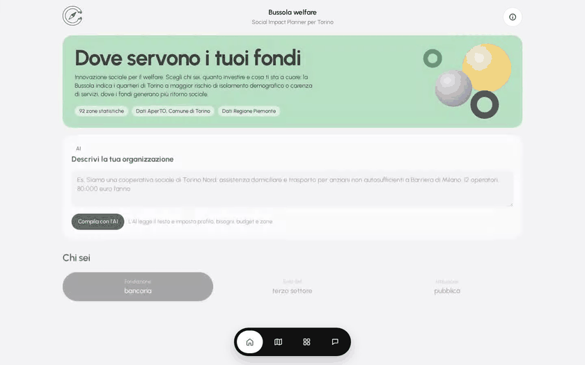

# Where Should Welfare Funding Go? Explainable Need Indices from Open Data in Turin

Welfare funding needs fine-grained evidence on need, yet Turin's open data are fragmented across municipal and regional sources. Compass is a decision-support system that combines 11 open datasets over the city's 92 statistical zones into three need indices weighted by principal component analysis, and matches them with an organisation's profile through a transparent score. A language model reads the organisation's description, explains the plan and answers questions about it in a somewhat RAG-like way, grounded only in the zone data, with every figure checked. The front end aims to follow human-centred design principles. In the demo, a foundation with 150,000 € receives five zones and 360 beneficiaries, with 93% robustness over 200 simulations. Whether expert-defined weights would agree with data-driven ones remains open.

Built for the Campionato Universitario AI 2026, Turin stage, 4 November 2026.

**Authors:** Francesco Screti, Francesco Rolando & Francesco Lazzarotto



---

## Project Structure

```
AI2B-Turin/
├── README.md
├── requirements.txt
├── docs/
│   └── METODO.md            # method, data limits and API contract (Italian)
├── data/
│   ├── raw/                 # downloaded open data (not versioned)
│   └── processed/           # zones.csv, zones.geojson, drivers.json (versioned)
├── src/
│   ├── build.py             # territorial indicators, PCA weights, k-means profiles
│   ├── api.py               # organisation profile, matching, planner, chat, FastAPI
│   └── catalog.json         # interventions, unit costs, indicator labels
├── serve/
│   ├── start_llm.sh         # LLM and embedding models on vLLM
│   ├── start_api.sh         # API and front end on port 8700
│   └── qwen38_nothink.jinja
├── web/                     # front end (HTML, CSS, JavaScript, MapLibre, D3)
└── presentation/            # pitch deck with the recorded demo
```

---

## How it works

| Step | What happens |
|---|---|
| 1. Zones | `src/build.py` computes need indicators for the 92 zones: ageing, widows, economic assistance, foreign residents, distance from health services. PCA weights them into three indices, k-means groups the zones into five profiles. |
| 2. Organisation | The organisation fills in a form or describes itself in a few lines; the language model turns the text into a profile. |
| 3. Matching | Each zone gets a score from need, service gap, mission fit and feasibility. |
| 4. Plan | The top zones get an intervention, beneficiaries, budget and a robustness index over 200 simulations. |

A transparent formula decides the ranking; the language model only writes the text, and every figure it writes is checked against the data.

| Component | Method |
|---|---|
| Language model | Qwen3.8-27B INT4 on vLLM |
| Embeddings | multilingual-e5-base |
| Unsupervised learning | PCA and k-means (scikit-learn) |

Details of the method and of the API are in `docs/METODO.md`.

---

## Data

| Source | Datasets |
|---|---|
| City of Turin, AperTO | population and foreign residents by zone; age by zone, 2013 and 2020; marital status and households by district, 2025; economic assistance; house numbers with coordinates |
| City of Turin, geoportal | boundaries of the statistical zones |
| Piedmont Region | ASL health facilities; pharmacies |

Raw files are not versioned, while the processed outputs in `data/processed/` are, so the API starts without rebuilding them. Known limits (estimated values for people living alone and widows, distortion of assistance data in central zones, 219 of 251 health facilities located) are described in `docs/METODO.md`.

---

## Setup

### Dependencies

```bash
python3 -m venv .venv && .venv/bin/pip install -r requirements.txt
```

### Data (optional)

Rebuild the indicators after updating `data/raw/`:

```bash
.venv/bin/python src/build.py
```

### Models and API

The start scripts were written for the team's Linux server with a GPU: `serve/start_llm.sh` contains paths to that machine and must be adapted before use.

```bash
mkdir -p logs
bash serve/start_llm.sh    # Qwen3.8-27B on port 8001 and multilingual-e5 on port 8002 (GPU)
bash serve/start_api.sh    # API and front end on port 8700
```

On any other machine the API alone starts with:

```bash
.venv/bin/uvicorn src.api:app --port 8700
```

Without the language model everything except "Compila con l'AI" still works: the plan text becomes a template and the chat falls back to fixed rules.

### Front end

The front end is served by the API on your machine, not by GitHub: once the API is running, open `http://127.0.0.1:8700`. Adding `?demo=1` starts a self-running walkthrough.

### Presentation

Open `presentation/index.html` in any browser, even offline. Arrow keys move between slides, F goes full screen.

---

## Future work

The index weights come from the data, through PCA. The next step is to ask domain experts, such as social workers and third-sector operators, to weight the same factors, then compare the two rankings and study the zones where they disagree. A user evaluation with funders and the missing data, such as older people living alone by zone, would complete the picture.

---

## AI Act

Compass works on aggregate data by statistical zone, does not assess individuals and does not decide access to public assistance, so it does not fall among the high-risk systems of Annex III, point 5 of Regulation (EU) 2024/1689. The chat states that answers are generated by an AI system and may contain errors, in line with the transparency obligations of Article 50.
